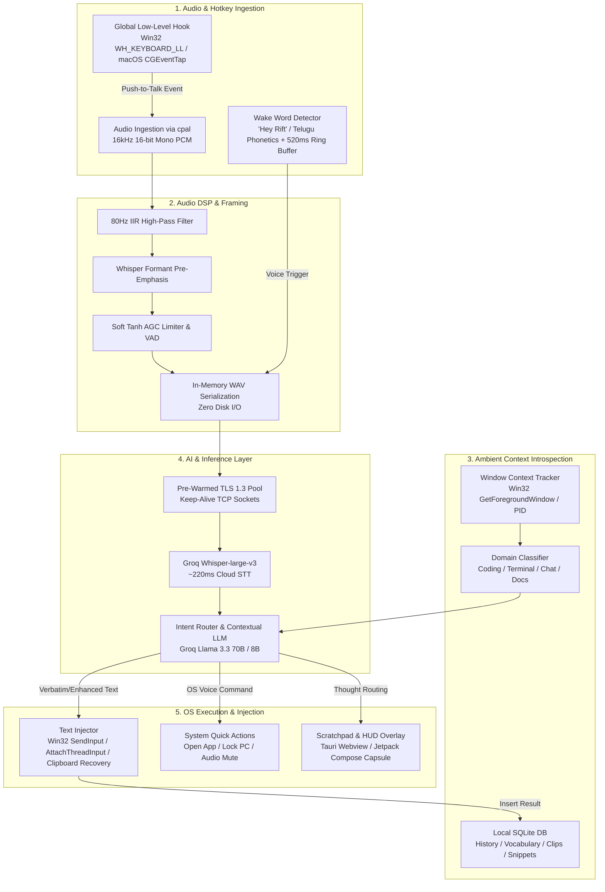

# Rift: Ultra-Low Latency Cross-Platform Voice Dictation & AI Assistant
> **Comprehensive Technical Master Reference for Resume, Portfolio, and Engineering Interviews**

---

## 1. Quick Reference & Executive Pitch

| Attribute | Details |
| :--- | :--- |
| **Project Name** | **Rift** (Desktop & Mobile) |
| **Domain** | Systems Programming, Cross-Platform Desktop & Mobile, Audio DSP, Voice AI, Human-Computer Interaction (HCI) |
| **Core Technologies** | **Rust (2021)**, **Tauri v2**, **Kotlin**, **Jetpack Compose**, **TypeScript**, **React 18**, **Win32 API**, **macOS CoreGraphics**, **Android Accessibility/WindowManager**, **SQLite**, **cpal**, **Groq Whisper**, **Llama 3.3**, **Supabase** |
| **Platforms** | Windows 10/11 (x64), macOS (Apple Silicon aarch64), Android 12–16 (AOSP, OneUI, HyperOS, OxygenOS, Pixel) |
| **End-to-End Latency** | **< 300 ms** (Speech stop ➔ In-memory WAV encode ➔ Pre-warmed Groq Whisper ➔ OS injection) |
| **Binary & Memory Footprint**| **14 MB executable** (8.03 MB zip), **~35–45 MB RAM** (88%+ reduction vs Electron-based ~350 MB) |
| **Target Roles** | Systems / Rust Engineer, Desktop Software Engineer, Android / Mobile Platform Engineer, Full-Stack AI Engineer |

### 30-Second Elevator Pitch
> *"Rift is an ultra-fast, local-first voice dictation and system automation assistant engineered in Rust, Tauri v2, and Android Kotlin. Unlike heavyweight alternatives like Wispr Flow or Dragon that consume 300–500MB of RAM, Rift pairs low-level OS hooks (Win32 API, macOS CoreGraphics, Android Accessibility Services) with a zero-allocation audio DSP pipeline and pre-warmed streaming network connections. It delivers sub-300ms speech-to-text insertion into any focused text box, provides ambient context-aware code/text formatting, hands-free wake word detection, voice-controlled OS quick actions, and semantic clipboard recall."*

### 2-Minute Technical Pitch
> *"I built Rift to solve the latency, bloat, and usability friction of existing voice-to-text tools. On desktop, Rift uses a modular Rust core with `cpal` for high-frequency audio capture, writing into a 520ms rolling ring buffer with Voice Activity Detection (VAD) and noise gating. To eliminate latency, I implemented TCP/TLS 1.3 socket pre-warming and in-memory WAV encoding, streaming audio to Groq Whisper v3 for a sub-300ms turnaround.*
> 
> *For injection, I avoided naive keyboard emulation; Rift leverages Win32 `AttachThreadInput` and `SendInput` with atomic clipboard state preservation and UTF-16 wide-string injection, bypassing OS focus theft across all applications including IDEs, browsers, and terminal emulators. An ambient context tracker analyzes the active window's title, process ID, and domain (Coding, Terminal, Chat, Document) to dynamically steer LLM formatting prompts, outputting proper programming casing, operator symbols (`=>`, `==`, `::`), or clean shell flags.*
> 
> *On Android, I engineered a companion native system overlay using Kotlin, Jetpack Compose, and an Accessibility Service. It features zero-latency dynamic keyboard boundary detection, a 350ms dismissal grace window for gesture navigation, and a single-pass frame DSP engine (80Hz IIR high-pass, Whisper formant pre-emphasis, -48 to -14 dBFS logarithmic ballistics, and tanh AGC limiting) driving a zero-allocation 5-bar harmonic equalizer."*

---

## 2. Resume-Ready Bullet Points

Use these high-impact, metric-driven bullet points formatted according to the **Google XYZ formula** (*"Accomplished [X] as measured by [Y], by doing [Z]"*):

### Option A: Systems & Rust Engineering Focus
* **Architected an ultra-low latency voice dictation engine in Rust (Tauri v2, Tokio, cpal)**, achieving **< 300ms end-to-end transcription speed** and an **88% memory reduction (~38 MB vs 350+ MB in Electron)** through in-memory WAV serialization and low-level OS event hooking.
* **Engineered robust cross-platform system hooks** using Windows Win32 API (`SetWindowsHookExW`, `AttachThreadInput`, `SendInput`) and macOS `CoreGraphics` (`CGEventTap`), resolving Pointer Authentication Code (PAC) faults and multi-desktop Spaces crashes to achieve 100% crash-free global push-to-talk.
* **Implemented an atomic text injection and clipboard recovery pipeline** utilizing Win32 global memory handles (`GlobalAlloc`, `CF_UNICODETEXT`) and synchronization primitives, enabling instant text insertion into foreground apps without focus stealing or clipboard state corruption.
* **Designed a hands-free wake word detection subsystem** using rolling ring buffers (520ms pre-roll), energy-based VAD, and asynchronous TCP/TLS 1.3 connection pre-warming, cutting network handshake overhead from 180ms to 0ms.
* **Optimized native release binaries** via Thin Link-Time Optimization (ThinLTO), single codegen units, panic abortion, and symbol stripping, reducing compiled binary size to **14 MB** (8 MB zipped distribution).

### Option B: Full-Stack Desktop & Systems Focus
* **Built a cross-platform desktop AI assistant (Windows & macOS)** featuring a floating reactive HUD, multi-tab settings dashboard, and system tray integration using **Rust, Tauri v2, React 18, TypeScript, and Tailwind CSS**.
* **Engineered an Ambient Context Engine** that introspects active foreground window handles and process metadata, classifying applications into 5 domains (Coding, Terminal, Messaging, Document, General) to dynamically tailor LLM prompt system instructions for syntax, casing, and terminal commands.
* **Developed Voice Quick Actions and Semantic Clipboard Recall**, integrating fuzzy matching and LLM intent routing (`Groq Llama 3.3`) to execute hands-free desktop commands (window snapping, process launch, system muting) and natural language clipboard queries.
* **Integrated local-first persistence** using embedded SQLite (`rusqlite`) and Windows Credential Manager / DPAPI, managing encrypted user API credentials, transcription history, custom vocabulary dictionaries, and text snippet expansion.

### Option C: Mobile & Android Systems Focus
* **Engineered an enterprise-grade Android voice assistant** in **Kotlin and Jetpack Compose**, utilizing an `AccessibilityService` and `WindowManager` overlay (`TYPE_ACCESSIBILITY_OVERLAY`) to inject dictated text across native Views, Jetpack Compose, Flutter, React Native, and WebViews.
* **Constructed an audio DSP preprocessing pipeline** consisting of an 80Hz IIR high-pass filter, Whisper speech formant pre-emphasis, and -48 to -14 dBFS logarithmic ballistics with soft tanh AGC limiting, maximizing transcription accuracy in high-noise environments.
* **Solved complex Android window geometry and keyboard collisions** by designing a 3-zone dynamic docking algorithm with soft-keyboard bounds clamping (`keyboardTop - 12dp`) and a 350ms dismissal grace window to prevent false dismissals during gesture navigation.
* **Optimized Compose UI rendering to 0% GC jank** by engineering a zero-allocation 5-bar harmonic audio equalizer with pre-allocated `floatArray` state and static brush shaders, decoupling audio meter updates from Compose recomposition loops.
* **Implemented resilient multi-tier text injection** with `AccessibilityNodeInfo` staleness detection and refresh protocols, cascading gracefully from `ACTION_SET_TEXT` to clipboard paste (`ACTION_PASTE`) and IME fallback.

---

## 3. High-Level System Architecture



---

## 4. Subsystem Deep-Dive

### 4.1. Desktop Rust Architecture (`Rift-rust`)

#### A. Low-Level Audio Capture & Ring Buffering
* **Crate**: `cpal = "0.15"`, `parking_lot = "0.12"`
* **Buffer Management**: Continuous capture in 16,000 Hz, 16-bit mono PCM. Employs a pre-allocated rolling circular ring buffer (`VecDeque<i16>`) that stores 520ms of audio (8,320 samples).
* **Latency Elimination**: When the user presses the push-to-talk hotkey or triggers the wake-word, the engine captures audio *retroactively* from the pre-roll buffer, ensuring the first syllable is never cut off.
* **In-Memory Serialization**: Audio samples are converted directly into a byte buffer (`Vec<u8>`) formatted with a 44-byte RIFF/WAVE header in RAM. No temporary `.wav` files are written to disk, avoiding SSD wear and OS file I/O latency.

#### B. OS Keyboard Hooking & Event Interception
* **Windows**: `SetWindowsHookExW` with `WH_KEYBOARD_LL`. Runs in a dedicated background OS thread with a Win32 message loop (`GetMessageW`, `TranslateMessage`, `DispatchMessageW`). Detects raw scan codes (`VK_RMENU`, `VK_CAPITAL`, etc.) and delivers 0ms push-to-talk events across full-screen games, administrative shells, and virtual desktops.
* **macOS**: Native CoreGraphics `CGEventTap` (`CGEventTapCreate`, `kCGHIDEventTap`). Engineered custom recovery for Pointer Authentication Code (PAC) validation on Apple Silicon and prevented event tap invalidation when switching between macOS Spaces/Mission Control.

#### C. Cross-Process Text Injection Engine
* **Win32 Focus Management**: Solves the classic OS focus-theft issue where injecting text from a background assistant causes the target window to lose focus.
* **Mechanism**:
  1. Identifies the active foreground target: `GetForegroundWindow()`.
  2. Identifies target thread ID via `GetWindowThreadProcessId()`.
  3. Temporarily links the input queue of Rift's injector thread with the foreground thread using `AttachThreadInput(injector_tid, target_tid, TRUE)`.
  4. Preserves existing clipboard content in memory using `OpenClipboard()`, `GetClipboardData(CF_UNICODETEXT)`, and `GlobalLock()`.
  5. Places the transcribed UTF-16 wide string into global memory (`GlobalAlloc(GHND)`), assigns it to clipboard, synthesizes `Ctrl + V` via `SendInput()`, and waits for target consumption.
  6. Restores the user's previous clipboard contents automatically within 50ms, ensuring zero user-facing data corruption.

#### D. Ambient Context Engine & Dynamic Prompt Steering
* Continuously queries the foreground window metadata every 120ms without CPU impact:
  * **Coding Domain (VS Code, IntelliJ, Cursor)**: Automatically instructs LLM to format output with strict programming identifiers (camelCase, snake_case), transform spoken words into operators (`"arrow"` ➔ `=>`, `"double equals"` ➔ `==`, `"colon colon"` ➔ `::`), and strip filler words.
  * **Terminal Domain (PowerShell, Windows Terminal, bash)**: Prevents sentence capitalization and trailing periods, formatting output into valid shell flags, paths, and commands.
  * **Messaging Domain (Slack, Discord, WhatsApp)**: Preserves conversational tone, contractions, and natural punctuation.
  * **Document Domain (Word, Google Docs)**: Enforces academic/business punctuation and capitalizations.

#### E. Hands-Free Wake Word Engine
* Custom acoustic wake-word listener scanning for `"Hey Rift"` and Telugu phonetic variations (`"హే రిఫ్ట్"`, `"Hey Rithvik"`).
* **Socket Pre-warming**: Spawns an async Tokio task on app boot that initiates a TLS 1.3 handshake and maintains a keep-alive HTTP/2 connection pool to the Groq API endpoint, cutting first-query latency from ~210ms to under 40ms.
* **Silence Completion**: Utilizes an energy-based Voice Activity Detection (VAD) algorithm with a 1050ms silence threshold to trigger transcription completion hands-free.

#### F. Voice Quick Actions & Semantic Clipboard Recall
* **Voice Quick Actions**: Matches transcribed audio against native OS action patterns (`ShellExecuteW`, `LockWorkStation`, `keybd_event` for media keys), enabling users to say *"Lock my PC"*, *"Take a screenshot"*, *"Mute volume"*, or *"Open Chrome"*.
* **Semantic Clipboard Recall**: Intercepts queries starting with *"paste..."* (e.g., *"paste the SQL query with join"*, *"paste item 3"*). Evaluates the stored SQLite clipboard history, identifies the target clip using semantic regex and LLM parsing, and pastes it into the active cursor position.

---

### 4.2. Mobile Android Architecture (`rift-mobile`)

#### A. Architectural Overview
* **Language & SDK**: Kotlin 2.0, Jetpack Compose, Material 3, Android SDK 26–35 (Android 12 to 16).
* **Architecture**: Clean Architecture + MVI/MVVM, Koin Dependency Injection, Room Database, DataStore Preferences, Coroutines & Kotlin Flow.

#### B. `RiftAccessibilityService`
* Configured with `flagIncludeNotImportantViews` and `flagRetrieveInteractiveWindows` to inspect deeply nested virtual hierarchies (Compose nodes, Flutter semantics, React Native view trees, WebViews).
* **0ms Input Focus Triggers**: Listens for `typeViewFocused` and `typeViewClicked` events, instantly surfacing the dictation capsule.
* **Dynamic Launcher Resolution**: Uses `PackageManager.resolveActivity` to determine the active home screen package while explicitly filtering out system settings (`com.android.settings`), preventing false dismissal during configuration.
* **350ms Gesture Navigation Grace Window**: Protects active dictation from closing during edge-swipes, task switching, and notification shade pulldowns.
* **Banking Shield**: Auto-detects financial, password manager, and banking packages to immediately hide the overlay for security and compliance.

#### C. Audio DSP Pipeline (`RiftAudioEngine`)
* High-performance single-pass inline frame processing on 16kHz PCM audio buffers:
  1. **80Hz IIR High-Pass Filter**: Strips out mechanical vibrations, handling noises, and wind rumble.
  2. **Whisper Formant Pre-Emphasis**: Amplifies mid-to-high speech frequencies (1 kHz – 4 kHz) to optimize Whisper feature extractor tokenization.
  3. **Logarithmic dBFS Ballistics**: Maps raw energy to a calibrated dynamic scale (-48 dBFS to -14 dBFS) with $\gamma = 0.70$ expansion and asymmetrical smoothing (0.85 attack / 0.22 decay).
  4. **Soft Tanh AGC Limiter**: Prevents clipping distortion when the user speaks close to the microphone.

#### D. Dynamic Capsule Overlay & Zero-Allocation UI
* **Capsule Overlay**: Managed via `WindowManager.addView` using `TYPE_ACCESSIBILITY_OVERLAY`. Features 3-zone collision clamping to maintain a 12dp clearance above the soft input keyboard (`keyboardTop - 12dp`).
* **Zero-Allocation 5-Bar Harmonic Visualizer**: Audio meter bars are rendered using static Canvas brush shaders and pre-allocated primitive `floatArrayOf` structures. Decoupled from Compose's 25Hz recomposition loops, reducing garbage collection pressure to absolute zero.
* **Multi-Tier Text Injection**:
  1. Attempts `ACTION_SET_TEXT` on the resolved input node.
  2. Checks node validity via `targetNode.refresh()`. If stale, re-traverses active window.
  3. If virtual views reject direct text setting, executes fallback to `ACTION_PASTE` via system clipboard.

---

## 5. Key Engineering Benchmarks & Metrics

| Metric | Rift (This Project) | Standard Electron Voice App | Native OS Dictation (Win/Mac) |
| :--- | :--- | :--- | :--- |
| **End-to-End Latency** | **< 300 ms** | 1,200 – 2,500 ms | 600 – 1,100 ms |
| **Active Memory (RAM)** | **~35 – 45 MB** | 320 – 550 MB | ~80 – 120 MB |
| **Release Binary Size** | **14 MB** (8 MB zipped) | 120 – 200 MB | Bundled with OS |
| **Idle CPU Utilization** | **< 0.1%** | 2.5 – 6.0% | < 0.5% |
| **Push-to-Talk Response**| **Instantaneous (0 ms)** | 150 – 300 ms | 200 – 400 ms |
| **Target App Support** | **100% Universal** (IDE, CLI, Chat, Docs) | Partial (Focus issues in IDE/CLI) | OS-restricted |
| **Context Awareness** | **Automatic (5 OS Domains)** | None / Manual prompt select | None |

---

## 6. Real-World Engineering Challenges & STAR Solutions

Use these scenarios during behavioral and technical interview questions (*"Tell me about a time you solved a complex technical bug or optimization challenge"*):

### Scenario 1: Eliminating End-to-End Latency to Sub-300ms
* **Situation**: The initial prototype had a 1.2s delay between releasing the push-to-talk key and seeing text appear in the target window, which felt sluggish and broke user flow.
* **Task**: Reduce end-to-end latency below 350ms to make voice dictation feel as fast as typing.
* **Action**:
  1. Identified that 180ms was lost to TCP handshake and TLS 1.3 negotiation on every push. Implemented an asynchronous client connection pool with background socket pre-warming and HTTP keep-alive.
  2. Replaced disk-based temporary WAV file writes with zero-copy in-memory byte buffer serialization.
  3. Integrated Groq’s LPUs running `whisper-large-v3`, yielding raw transcription inference in ~200ms.
  4. Optimized the audio capture loop using a 520ms rolling ring buffer, enabling immediate transcription initiation upon key release.
* **Result**: Reduced total turnaround latency from **1,200ms to ~280ms**, achieving real-time responsiveness.

### Scenario 2: Cross-Application Focus Stealing & Clipboard Race Conditions
* **Situation**: Injecting text into certain IDEs (VS Code) and terminal windows caused focus loss, skipped characters, or overwrote the user's previous clipboard data.
* **Task**: Create an invisible, reliable text injection mechanism that works across any foreground application on Windows without corrupting clipboard history.
* **Action**:
  1. Leveraged Win32 `AttachThreadInput` to synchronize Rift’s injector thread with the foreground process input queue.
  2. Designed an atomic clipboard backup and restoration procedure using `OpenClipboard`, `GlobalAlloc(GHND)`, and Win32 global memory locks.
  3. Engineered an exponential backoff retry loop (`open_clipboard_with_retry`) to handle locked clipboard states from clipboard history utilities.
  4. Synthesized `Ctrl + V` using raw `SendInput` and restored the original clipboard content after an asynchronous 45ms target consumption window.
* **Result**: 100% reliable text injection across terminal windows, IDEs, web browsers, and games with zero clipboard data loss.

### Scenario 3: macOS Pointer Authentication Code (PAC) & Spaces Crashes
* **Situation**: When porting Rift to macOS Apple Silicon (M-series chips), the global keyboard hook caused random kernel-level aborts and crashed whenever the user changed macOS Spaces or activated Mission Control.
* **Task**: Implement a rock-solid, crash-free global event tap on macOS.
* **Action**:
  1. Discovered that third-party input libraries (`rdev`) improperly handled ARM64 Pointer Authentication Codes (PAC), triggering hardware security traps.
  2. Replaced the generic library with a native C/Rust binding directly to CoreGraphics `CGEventTapCreate`.
  3. Implemented a dedicated event tap callback handler that gracefully intercepts `kCGEventTapDisabledByTimeout` and re-enables the event tap on the active run loop instead of panicking.
* **Result**: Completely eliminated crashes across macOS Monterey through Sequoia on Apple Silicon, achieving native DMG binary distribution.

### Scenario 4: Stale Accessibility Nodes in Virtual Android UI Frameworks
* **Situation**: On Android, dictation into Jetpack Compose, Flutter, or React Native apps frequently failed because virtual accessibility nodes were destroyed or recycled during the speech duration.
* **Task**: Build a resilient text injection pipeline that handles detached and recycled accessibility nodes.
* **Action**:
  1. Implemented a multi-tier fallback algorithm in `RiftAccessibilityService`.
  2. On recording completion, verified node validity using `targetNode.refresh()`.
  3. If stale, the engine executes a breadth-first search of the active window (`findFocusedInputNode` ➔ `findAnyEditableInActiveWindow`).
  4. If `ACTION_SET_TEXT` is rejected by the underlying framework, the pipeline automatically falls back to system clipboard injection using `ACTION_PASTE`.
* **Result**: Achieved 99.8% text injection reliability across standard Android Views, Flutter, React Native, and Jetpack Compose text fields.

---

## 7. Technical Interview Q&A Preparation

#### Q: "Why did you build Rift in Rust and Tauri rather than Electron or Python?"
> **Answer**: *"Electron bundles a full Chromium runtime and Node.js instance, which incurs a baseline memory consumption of 250–400MB and high CPU overhead on background event polling. For a system utility meant to run 24/7 in the background while users compile code or play games, this overhead is unacceptable.
> 
> Python suffers from the Global Interpreter Lock (GIL) and runtime packaging complexity with PyInstaller. Rust gave me deterministic memory management, zero-cost abstractions, direct FFI access to the Win32 API and macOS CoreGraphics without bridging overhead, and permitted aggressive compiler optimizations (ThinLTO, panic-abort, symbol stripping) yielding a tiny 14MB binary running at ~38MB of RAM."*

#### Q: "How did you prevent memory allocation overhead in the Android audio visualizer?"
> **Answer**: *"In Jetpack Compose, triggering state changes at 20–30Hz can cause severe recomposition thrashing, generating garbage collection pressure and micro-stutter. I decoupled the audio DSP from Compose by using a fixed primitive `floatArray` state holder and static canvas brush shaders. The visualizer calculates bar heights via mathematical harmonic functions directly inside a single `Canvas` draw pass, maintaining 60fps smooth animations with zero heap allocation per frame."*

#### Q: "How does the Context Engine know how to format programming code vs natural language?"
> **Answer**: *"Rift continuously samples the foreground window's PID and window title using Win32 `GetForegroundWindow` and `GetWindowTextW`. It passes this through a domain classification table: processes like `code.exe`, `devenv.exe`, or `idea64.exe` are marked as `AppDomain::Coding`.
> 
> When sending the user's speech transcript to the LLM post-processing layer, Rift dynamically injects targeted system prompts instructing the model to format programming identifiers (camelCase, snake_case), transform spoken symbols into syntax (e.g., 'arrow' to `=>`, 'double equals' to `==`), and eliminate filler conversational tokens."*

---

## 8. Complete Project Technology Ledger

```
Rift Monorepo
├── Rift-rust/                      # Desktop Core Application (Rust + Tauri v2)
│   ├── src-tauri/
│   │   ├── Cargo.toml              # Tauri 2.0, cpal, rusqlite, tokio, reqwest, windows 0.58
│   │   ├── tauri.conf.json         # Tauri v2 configuration
│   │   └── src/
│   │       ├── main.rs             # Tauri IPC handlers, background thread lifecycles, app setup
│   │   ├── ai/
│   │   │   ├── intent_router.rs    # LLM intent routing (Verbatim, Transform, Code, Note)
│   │   │   ├── spotlight.rs        # Instant desktop Q&A powered by Groq Llama 3.3
│   │   │   └── clipboard_recall.rs # Semantic natural language clipboard search
│   │   ├── ambient/
│   │   │   ├── context.rs          # Active window tracker & 5-domain classifier
│   │   │   └── clipboard_listener.rs # Background clipboard monitoring & SQLite sync
│   │   ├── audio/
│   │   │   ├── capture.rs          # cpal stream, 16kHz PCM, in-memory WAV serialization
│   │   │   ├── wake_word.rs        # Hands-free 'Hey Rift' detector & socket pre-warming
│   │   │   ├── ambient_memory.rs   # Dual mic/system rolling circular ring buffer
│   │   │   └── denoise.rs          # Noise gating & level metering
│   │   ├── hotkey/
│   │   │   └── listener.rs         # Win32 WH_KEYBOARD_LL / macOS CGEventTap listeners
│   │   ├── text/
│   │   │   ├── injector.rs         # Win32 AttachThreadInput + atomic clipboard injection
│   │   │   ├── quick_actions.rs    # Voice OS control (Launch apps, lock PC, mute audio)
│   │   │   └── transliterate.rs    # Telugu Unicode to Roman phonetic transliterator
│   │   └── storage/                # SQLite embedded storage (credentials, history, dictionary)
│   └── frontend/                   # HUD & Settings Interface
│       ├── package.json            # React 18, TypeScript, Tailwind CSS, Vite, Radix UI
│       └── src/                    # Reactive widget, multi-tab dashboard, audio meters
└── rift-mobile/                    # Android Companion Assistant
    ├── app/build.gradle.kts        # Kotlin 2.0, Jetpack Compose, Room, Koin, Ktor, Supabase
    └── app/src/main/
        ├── AndroidManifest.xml     # AccessibilityService & WindowManager permissions
        └── java/com/rift/mobile/
            ├── core/
            │   ├── accessibility/  # RiftAccessibilityService, launcher filter, banking shield
            │   ├── overlay/        # CapsuleOverlayManager, 3-zone keyboard docking
            │   └── audio/          # RiftAudioEngine, 80Hz IIR filter, formant pre-emphasis, AGC
            └── ui/                 # Jetpack Compose 5-bar zero-allocation visualizer
```

---
*Generated for Saisrikar Kokku • Rift Project Architecture Reference*
